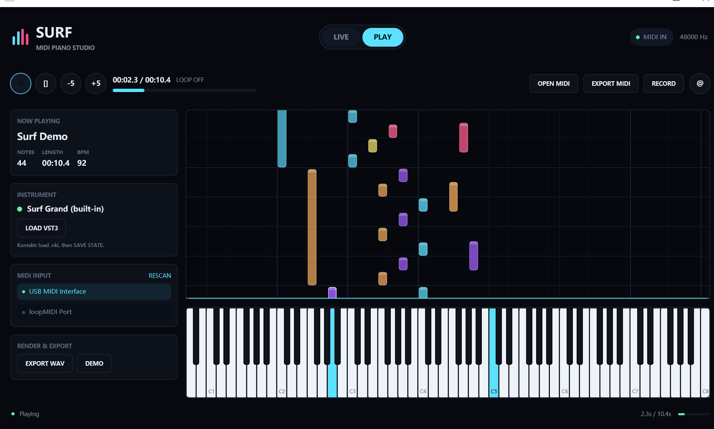

# Surf

A desktop MIDI studio written in Rust with [GPUI](https://www.gpui.rs/). Play a MIDI keyboard and watch the notes on a piano visualizer, open MIDI files and watch them fall onto the keys, record what you play, and render it to WAV with the built-in piano or your own VST3 / VST2 instruments, including Kontakt.



## Features

- **Live playing**: low-latency MIDI input with sustain pedal support. The computer keyboard works as a piano too.
- **Playback**: open `.mid` files, with play / pause / seek / loop.
- **Recording**: capture a take and export it as a Standard MIDI File.
- **Instruments**: a built-in piano that needs no setup, plus VST3 and VST2 hosting. Each plugin runs in its own process, so a crash can't take the app down.
- **Export**: type-1 MIDI files and 24-bit / 48 kHz WAV.
- **Runs without an audio device**: the timeline and visuals keep working, which is handy over remote desktop or in CI.

> **Status:** early development. The current build runs on Windows 10/11 x64. macOS and Linux support, multi-track editing, and a Logic-style interface are in progress. See the [UI design](docs/design/README.md) and the [roadmap](docs/architecture.md#roadmap-mapping).

## Get started

### Requirements

- Rust stable (tested with 1.94)
- Windows: Visual Studio Build Tools with the MSVC toolchain and the Windows SDK
- Optional: a MIDI keyboard; VST3 / VST2 instruments

### Build and run

The repository builds two binaries, `surf` (the app) and `surf-vst-host` (the plugin host). Build both, then run the app:

```powershell
cargo build
cargo run --bin surf
```

If the build can't find the MSVC headers, use the wrapper script. It loads the Visual Studio environment first:

```powershell
powershell -ExecutionPolicy Bypass -File tools/build.ps1 run
```

The first build downloads GPUI's dependency tree (500+ crates) and takes several minutes.

### Basic use

- Plug in a MIDI keyboard and play, or click the window and use `A W S E D F T G Y H U J K O L P ;`.
- `OPEN MIDI` loads a file; `DEMO` loads a short example. `Space` plays and pauses.
- `RECORD` captures a take; `EXPORT MIDI` / `EXPORT WAV` save it.
- `SCAN` lists installed plugins; click one to use it as the instrument.

Loading plugins, saving their state, and the Kontakt workflow are covered in [docs/plugins.md](docs/plugins.md).

## Development

```powershell
cargo test --lib                 # unit tests
cargo run --example render_demo -- out.wav     # render the demo with the built-in piano
cargo run --example vst_scan_list               # print what SCAN finds
```

The `examples/` folder also has probes for each step of plugin loading and audio transport. They are listed in [docs/troubleshooting.md](docs/troubleshooting.md#diagnostic-examples).

### Documentation

| Document | Contents |
|---|---|
| [docs/architecture.md](docs/architecture.md) | System, module, and feature-level architecture, current and target |
| [docs/design/](docs/design/README.md) | UI design spec, design tokens, interactive prototype |
| [docs/plugins.md](docs/plugins.md) | Using VST instruments and Kontakt |
| [docs/troubleshooting.md](docs/troubleshooting.md) | Build problems, plugin crashes, logs, debug switches |
| [docs/vendor-patches.md](docs/vendor-patches.md) | Why `vendor/` exists and what each patch fixes |
| [docs/vst-kontakt-research.md](docs/vst-kontakt-research.md) | Background research on GPUI, VST3, and Kontakt (Chinese) |

### Repository layout

```
src/
  app.rs          GPUI views
  song.rs         MIDI file model and tempo map
  midi_input.rs   live MIDI input
  recorder.rs     recording
  audio/          engine, built-in synth, offline render, plugin client and IPC
  bin/vst_helper.rs   the surf-vst-host plugin host
vendor/           patched forks of vst3-host and vst (see docs/vendor-patches.md)
examples/         smoke tests and diagnostic probes
```

### Contributing

Issues and pull requests are welcome. Before opening a PR, run `cargo fmt`, `cargo clippy`, and `cargo test --lib`. For larger changes, check [docs/architecture.md](docs/architecture.md) first: the codebase is moving to a multi-crate workspace, and new code should fit that structure.

## License

Licensed under either of [MIT](LICENSE-MIT) or [Apache-2.0](LICENSE-APACHE), at your option.

The forks in `vendor/` keep their original MIT licenses: [`vst3-host`](https://github.com/HelgeSverre/rust-vst3-host) © Helge Sverre, and [`vst-rs`](https://github.com/RustAudio/vst-rs).

Kontakt, Native Instruments, and other product names are trademarks of their respective owners. Surf does not include or distribute any commercial plugin or sound library.
